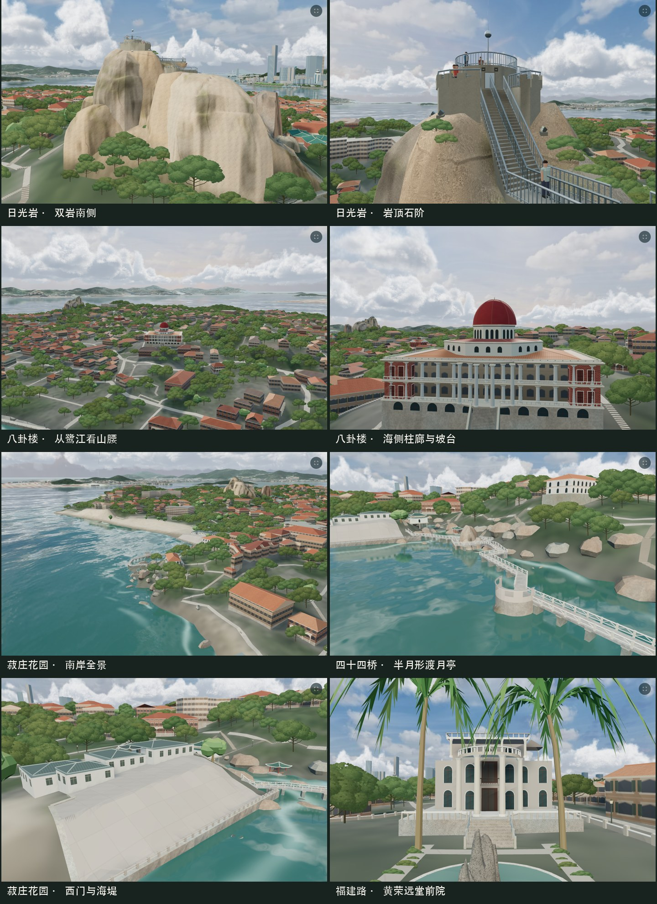

# XM-008　鼓浪屿山顶、山腰与南岸地标

基准日为北京时间 2026 年 11 月 25 日。本次在当前项目源码制作，开发者复查使用独立生产构建 5398。直接看日光岩，先开[双岩侧景](http://127.0.0.1:5398/?tour=rock-profile&time=afternoon)，再开[岩顶石阶](http://127.0.0.1:5398/?tour=rock)。轻型机内按 **M** 展开航线图，在「鼓浪屿」下选机位，按 **F** 返回原飞行。场景也用于自由飞行。正式大厅的同机位对照由 XM-011 独立验收。

## 实际改动和复查位置

| 地段 | 在游戏中看什么 | 入口 |
| --- | --- | --- |
| 日光岩 | 从南侧对看主峰立岩与东南卧岩，外侧岩片在岩肩形成斜向的凹口和翻边。近景可看干燥岩面与深色水痕的交界。沿用岩顶圆台、分道石阶、跨缝短桥和东壁题刻 | [双岩](http://127.0.0.1:5398/?tour=rock-profile&time=afternoon) · [石阶](http://127.0.0.1:5398/?tour=rock) · [题刻](http://127.0.0.1:5398/?tour=rock-inscriptions) |
| 八卦楼 | 从鹭江辨认红穹顶、八角鼓座和环绕鼓座的坡屋面。近看曲面门廊的四根通高柱、两侧砖翼的红褐百叶、台阶和石砌侧墙 | [从海上看](http://127.0.0.1:5398/?tour=island) · [海侧柱廊](http://127.0.0.1:5398/?tour=bagua-gallery) |
| 菽庄花园 | 沿四十四桥看北段拱腹和镶边，顺栏杆开口进入无顶的半月形渡月亭。西门、相邻五个屋段、园路、临海平台和挡土墙按地图分开建模。桥墩和礁石下缘取局部海床高度 | [南岸远景](http://127.0.0.1:5398/?tour=garden) · [桥上近景](http://127.0.0.1:5398/?tour=garden-bridge) · [西门与海堤](http://127.0.0.1:5398/?tour=garden-shore) |
| 黄荣远堂 | 福建路 32 号，与海天堂构隔路相望。先在前院看水池、叠石和两棵高棕榈，再看四根柱子围成的半圆门廊、门后的小阳台、退台外廊和东南角亭。调整后的水池机位在树冠外。向西南至福建路街侧约 20 米，可回望两院。[新入口与街侧复拍](street/README.md) | [院内近景](http://127.0.0.1:5399/?tour=huangrongyuan) · [海天堂构](http://127.0.0.1:5398/?tour=haitiantang) |
| 内厝澳街坊 | XM-009 提供的两个既有入口都在航线图内，可从屋顶低空下到笔山洞西侧坡巷 | [屋顶低空](http://127.0.0.1:5398/?tour=neicuoao-roofs) · [坡巷街口](http://127.0.0.1:5398/?tour=bishan-lane) |

## 外观时相与运营证据

- **日光岩和八卦楼的相对轮廓。** 新华社记者林善传 2026-08-22 拍摄的同框照片覆盖岩顶、树林和八卦楼，10 月 31 日发稿。日光岩另以 2025-02-09 的实拍核对山顶从山下露出的范围，历史近景用于辨认立岩和梯道。岩片剖面、细裂隙的走向和岩面色值属于游戏估绘。92.7 米沿用既有岩顶标高。[新华社图片及图说](https://i.ifeng.com/c/8xfKCzsb6x2) · [2025 年日光岩实拍](https://commons.wikimedia.org/wiki/File:Sunlight_Rock_2.jpg) · [既有参考与影像署名](../../../../public/scenery/credits.json)
- **八卦楼修缮。** 2019-09-26 的近景用于核对石柱、砖翼与入口台阶的形制。2024-02-06 修缮后重新开放，四段式通高百叶和红褐木色有修缮记录。2026 年秋季发布的活动把风琴博物馆、菽庄花园和日光岩列入 11 月 1 日至 12 月 31 日的参观项目。游戏估绘了穹顶起拱、鼓座高度、灰浆和石阶宽度。[遗产档案影像](https://whc.unesco.org/en/documents/158224/) · [修缮前正面](https://commons.wikimedia.org/wiki/File:Bagua_Mansion,_Kulangsu,_2019-09-26_01.jpg) · [修缮后的门窗和重新开放时间](https://news.xmnn.cn/xmxw/202402/t20240207_126981.html) · [秋季活动](https://news.xmnn.cn/xmxw/202610/t20261029_458435.html)
- **菽庄花园。** 2023-10-22 从港仔后沙滩拍摄的照片覆盖西门灰绿屋面、白墙及临水石堤。2026-06-16 的游园记述确认了四十四桥、礁石和半月形渡月亭的关系；该日期是刊发日。2026-11-10 02:51 UTC 的 Sentinel-2 影像覆盖整岛，可辨南侧沙带与两端岬角，10 米分辨率不足以定位单块岸石。临海平台、园路、门屋与挡土墙取 OSM 轮廓。石材颜色、栏杆样式、桥跨、屋脊和水下基脚深度属估绘；游戏海面固定在 Y=0.12 米。[西门实拍](https://commons.wikimedia.org/wiki/File:20231022_Shuzhuang_Huayuan.jpg) · [游园记述](https://mzj.sh.gov.cn/lnb-lyxx/20260616/19ddd401ff844b559dab2365524d0b35.html) · [景区运营方](https://www.glyylq.cn/article.php?id=157) · [地图上的石堤](https://www.openstreetmap.org/way/1526657613) · [XM-004 岸坡资料](../../XM-004/island/README.md)
- **黄荣远堂。** 使用 H2v5o68z 于 2025-02-09 09:00 拍摄的正面照片核对通高门廊、双侧棕榈及池中叠石。联合国教科文组织的正面资料标注为 2010 年，用于核对庭园布局。福建省公布的保护范围明确了福建路和院墙相邻的方向。厦门大学 2025 年记录对文物建筑开展数字测绘，项目未取得其点云。福建省 2026-07-10 的材料确认黄荣远堂活化为唱片博物馆，尚无 11 月 25 日当日营业核验。主楼用 12 点地图轮廓，围墙沿博物馆地块近似，背立面、退台标高、盆池尺寸、棕榈位置与颜色按照片估绘。[2025 年原始照片及 EXIF](https://commons.wikimedia.org/wiki/File:鼓浪屿黄荣远堂.jpg) · [遗产档案](https://whc.unesco.org/en/documents/158225/) · [建筑师调研](https://www.zsad.com.cn/news_info/id-548.html) · [保护范围](https://www.fj.gov.cn/yy/wxym/zfgbwxts/201605/t20160503_1183826.htm) · [厦大测绘报道](https://en.xmu.edu.cn/info/1086/19782.htm) · [2026 年功能记录](https://www.fujian.gov.cn/zwgk/ztzl/sxzygwzxsgzx/flsxkmh/202607/t20260710_7176227.htm) · [主楼轮廓](https://www.openstreetmap.org/way/642493152)

## 构建与校核

- 桌面 1200×750 由双岩侧景开场，实点航线图余下 12 个入口，再按 F 回到高崎跑道。在总览和三丘田分别显示「鼓浪屿」和「三丘田码头」。逐站记录中没有脚本异常或 console.error。430×800 竖屏另查日光岩、黄荣远堂和菽庄两处入口。[实际运行记录](runtime.json) · [竖屏记录](portrait.json) · [竖屏截图](portrait.jpg)
- 用 XM-004 最终 10 米地形生成实际地标，再用竖线与游戏三角形求交。四十四桥拱跨中点的海床、拱腹、路面高程依次为 −0.81、2.45、3.67 米；中段墩脚最低顶点为 −4.93 米，当地海床为 −4.57 米；南端园路落点的地面和桥面分别是 9.73、10.03 米。西门门洞处的铺装比地面高 0.27 米。游戏坐标和两端墙顶采样可复查。[断面、地形指纹和碰撞抽查](checks.json)
- 城市底库里的黄荣远堂主楼 1 条、西门及翼屋 6 条、海天堂构 5 条均由专用模型接管。西门东翼的平面呈凹形，其顶点平均值落在露天通道，另用原轮廓边界识别。运行网格检查和生产构建均通过，Vite 报告已有的大分块尺寸提示。[复跑脚本](check.mjs) · [构建记录](build.log)
- 复跑开发构建用 `npm run build -- --outDir /private/tmp/xm008-heritage-preview --emptyOutDir`，之后用 `python3 -m http.server 5398 --bind 127.0.0.1 --directory /private/tmp/xm008-heritage-preview` 查看。用 `node docs/acceptance/2026-11-25/xm008-heritage/check.mjs` 复跑离线断面和去重检查。

独立验收尚待 XM-011 对正式构建复拍，包括连续自由飞行和岸边移动中的观感。执行自检未验证室内、逐台阶步行、动态潮位或真机触屏操作。[独立验收的制作前同区基线](../xm-008-baseline/README.md) · [本次验证 Space 收尾回执](space-finish.json)
