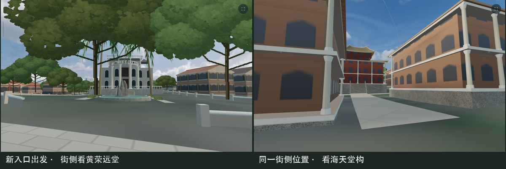

# XM-008　黄荣远堂至海天堂构的街侧复查

**现场判断。** 默认水池机位朝海天堂构转身后，视线贴近一株通用树冠。其游戏中心 X/Z 为 −5755、3795，距取景点 3.4 米，地面高 19.5 米，树冠大小参数 14 米。它由岛内植被生成器根据光学颜色、土地覆盖、建筑及道路掩膜抽样放置，在不同方向绘制朝向相机的树冠图像。相机距其中心很近，反向取景时树叶铺满大半屏。水池前的两株棕榈属于单独建模的庭园植栽。[场景中实际树冠](crowns.json) · [机位、道路与建筑平面](plan.png) · [植被生成依据](../../../../../tools/prepare-gulangyu.py)

在同一生产分块、同一相机位置和朝向临时隐藏这一株树冠，入口通道和对面翼楼随即露出，尚有第二株较远的树遮住部分立面。随后恢复该实例，用正常键盘和拖动操作取证。两张诊断图分别记录原画面与临时隐藏单株的效果。[水池原位转身](turn-original.jpg) · [临时隐藏单株后的诊断画面](diagnostic-one-crown-hidden.jpg)

**实景依据。** 实地园林调查描述庭院轴线两侧有高棕榈，池东种有榕树、樟树等阔叶植物。2025-02-09 的院内正面实拍可识别棕榈、叠石与两侧树木；照片没有覆盖拍摄者身后的街面。在水池机位坐标另查 Esri 世界影像，原始影像为 Vantor LG04，拍于 2025-03-20，源分辨率 0.34 米，元数据精度字段为 8.47 米。俯视可辨庭院西侧树冠与入口开敞处，精度不足以核实游戏中这 3.4 米的株位差。保留现有植栽和正面机位。[园林调查](https://www.fjdaily.com/app/content/2022-05/24/content_1455999.html) · [原始正面照片](https://commons.wikimedia.org/wiki/File:鼓浪屿黄荣远堂.jpg) · [水池处影像元数据及源查询](imagery-metadata.json)

## 已交付的机位修正

沿水池边缘向东北移动眼点 7.56 米，下降 2.20 米，复用原 URL 和原航线图项目。只改此机位的眼点、注视点和视角。双棕榈、水池、楼体、通用树冠及其他机位均沿用本轮构建。修正前位姿见上面的诊断记录。[原机位与新机位的正反向对照](camera-comparison.jpg) · [源码](../../../../../src/route.js#L262)

| 实测 | 眼点 X / Y / Z，米 | 正面朝向及竖直视场 | 回望海天堂构 |
| --- | --- | --- | --- |
| 原入口，桌面 | −5751.6 / 25.6 / 3795.2 | 32.9°，57° | 阔叶树冠贴近镜头，前景被大面积遮住 |
| 新入口，1120×680 | −5744.9 / 23.4 / 3791.7 | 14.8°，67°，注视点 −5740.5 / 24.0 / 3775.0 | 在同一眼点向西南约 232° 转身，能见翼楼和主入口通道 |
| 新入口，430×800 | 与新桌面眼点相同 | 20.2°，82.93°；向主楼微调注视点 | 同一眼点能见树下的对街入口 |

用实际场景中每株阔叶树冠的最大绘制半宽作平面检查。原遮挡树的中心距从 3.41 米增至 10.63 米，该实例半宽为 9.14 米，净距 1.48 米。另一株近树的中心距为 10.34 米、半宽 8.74 米，净距 1.60 米。正面仍能看到门廊四柱、水池和楼顶退台。反向仍有树叶自然遮住部分屋顶。[桌面数据](after.json) · [竖屏数据](portrait.json) · [竖屏正面](portrait-front.png) · [竖屏原地转身](portrait-reversed.png)

## 街侧复拍与整合验收

1. 打开[修正后的独立生产入口](http://127.0.0.1:5399/?tour=huangrongyuan&time=morning)，或在轻型机的 **M → 鼓浪屿 → 黄荣远堂** 选择原机位。先看四柱和水池，再原地转到西南约 232° 核对街树与对街入口。
2. 从新眼点对准西南约 **224°** 的院门，保持自由移动 **1×**，按 **W + Q** 约 **0.6 秒**。到海拔约 **21 米**松开。此次落点 X/Z 为 −5758.4、3805.9，距新机位约 19.6 米，距上轮街侧落点约 0.5 米。在同一点，朝东北看黄荣远堂，朝西南约 **235°** 看海天堂构。
3. 旧构建的复走路线仍可用。由[旧水池机位](http://127.0.0.1:5398/?tour=huangrongyuan)初始朝向出发，以 **S + Q** 后退约 **13.2 米**、下降约 **4.3 米**，也可到街侧。此前独立验收还在原位升到约 38 米，看到了对街主楼。[旧路线实拍](two-facades.jpg) · [旧路线坐标](route.json) · [独立验收抬升机位](../../xm-008-integrated/huang-raised-reverse.png)

独立预览 5399 实际加载 `game-BflBCur6.js`。生产构建和既有网格检查通过，普通入口、桌面和竖屏的正反向、从菜单重新选点均已验证。整合构建可从[正式大厅同一参数](http://127.0.0.1:5187/?tour=huangrongyuan&time=morning)按上面两步复验，并以眼点、视角和截图比对。正式构建的独立复验、真机触控及现场逐株位置尚待核实。执行自建 Space 66 已关闭。[构建日志](build.log) · [菜单复查](menu.json) · [浏览器回执](space-finish.json)
