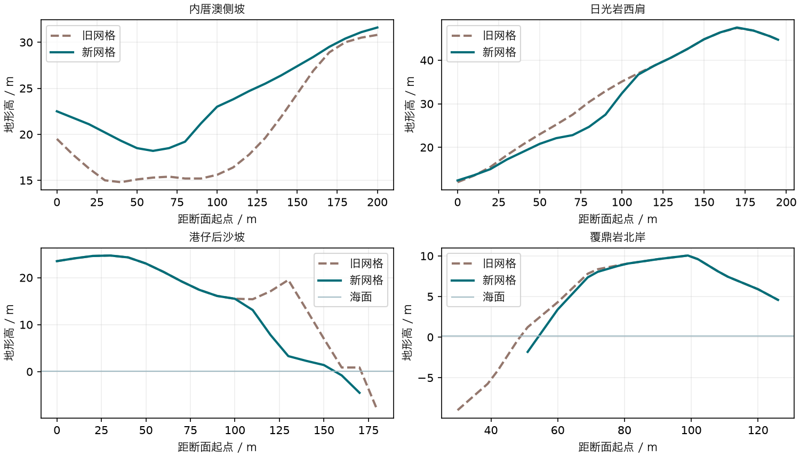

# XM-004　鼓浪屿地形地貌

基准日 2026-11-25。打开[鼓浪屿全岛](http://127.0.0.1:5187/?tour=gulangyu)、[内厝澳](http://127.0.0.1:5187/?tour=neicuoao)、[双岩侧景](http://127.0.0.1:5187/?tour=rock-profile)、[菽庄花园](http://127.0.0.1:5187/?tour=garden)或[皓月园](http://127.0.0.1:5187/?tour=haoyue)。从海上看沙带，用自由观察沿岸抬升，看沙坡向山脚过渡。

## 机位与断面

用竖直射线与 Three.js 场景中名为「鼓浪屿山地与湾岸」的网格相交，再与同坐标的飞行地面查询比对。CSV 包含每条断面的全部坐标，空值表示该处没有参与绘制的地形三角形。以下为游戏高度，单位米。[原始断面](profiles.csv)

| 地段 | 观察到的误差与改动 | 示例点 X、Z | 旧 → 新 |
| --- | --- | --- | ---: |
| 内厝澳侧坡 | 坡肩在旧网格中形成较低的平台。依据雷达表面模型的局部起伏，恢复朝内陆抬升的肩部 | −6890，3700 | 15.6 → 23.0 |
| 日光岩西肩 | 山麓到既有岩顶之间的一段坡面过于凸出，向鞍部回落的起伏偏弱 | −6670，3850 | 30.4 → 24.7 |
| 港仔后沙滩 | 旧岸坡把沙带推到接近山脚的高度。按沙地轮廓放低滩面，将上缘平滑接回后坡 | −6440，4230 | 19.5 → 3.3 |
| 覆鼎岩北岸 | 近水岩肩与浅海边缘沿用同一托高规则。调整陆侧岩肩和已有岬角下缘，保留主岩体与海上栈道 | −5400，3980 | 4.3 → 3.4 |

旧版使用 10 米步长的 Terrarium 重采样地形，海岸向内按统一上限限高。绘制阶段还把部分负高程顶点抬至 0.88 米，飞行与建筑查询读取原网格。新版直接使用细网高度绘制；水下网格仍有原本的 −12 米截底和全水单元剔除，飞行地面在海上取零。干地断面样点的射线高度与地面查询在记录精度 0.001 米内一致。

## 数据与适用范围

- **山脊与西坡。** 取 Copernicus GLO-30 的 N24 E118 原始地块，裁出全岛及邻岸 83 × 76 个原始像元。水平基准为 WGS84，垂直基准为 EGM2008，原始间距约 30 米。主要雷达采集期为 2011–2015，本岛各像元的具体拍摄日未核实。采用相对起伏，滤去较大尺度的高程差，限制校正幅度，并避开建筑、码头与峰顶。DSM 包含树冠和屋顶，Terrarium 底图在此地块的原始采集日和统一垂直基准未确认。10 米网格与 0.1 米存储单位只描述游戏数据。[Copernicus 产品与基准](https://dataspace.copernicus.eu/explore-data/data-collections/copernicus-contributing-missions/collections-description/COP-DEM) · [此次使用的原始地块](https://copernicus-dem-30m.s3.amazonaws.com/Copernicus_DSM_COG_10_N24_00_E118_00_DEM/Copernicus_DSM_COG_10_N24_00_E118_00_DEM.tif)
- **海滩、岬角与水陆边界。** 核查 118.051°–118.074°E、24.437°–24.458°N 的 Sentinel-2 L2A 目录。11 月 23 日整岛被云覆盖，11 月 13 日南岸和山脊受云遮挡。可同时辨认全岛坡地、港仔后连续浅色沙带及两端岬角的是 **2026-11-10 02:51:01 UTC** 影像，原始真彩色分辨率 10 米。海岛研究中心的南部海滩项目资料独立记载港仔后位于日光岩山麓、东邻菽庄、滩面较平缓，岛体为花岗岩基岩岛。项目方案页面的 2013 年日期没有用作现场拍摄日或竣工日。[影像裁片](sentinel-20261110.png) · [原始影像元数据](https://earth-search.aws.element84.com/v1/collections/sentinel-2-l2a/items/S2A_50RPN_20261110_0_L2A) · [自然资源部海岛研究中心](https://www.ircmnr.com/html/web/kexueyanjiu/keyanxiangmu/119.html)
- 平面定位沿用项目已有沙地、岩岸与海岸数据，使已有岸距纹理、海面着色器和地标同位。沙滩横坡、岩肩级差、单块花岗岩的细部及拍摄潮位均无同期实测断面。游戏海面 Y=0.12 米，未建立本地潮位与 EGM2008 的换算。日光岩保留已有 92.7 米平台设定，覆鼎岩保留已有 29.5 米台面设定，均未在 DEM 上叠加相同高度。
- 影像署名为 Contains modified Copernicus Sentinel data (2026)。高程产品署名见游戏[地理数据来源](../../../../public/geo/credits.json)。

## 生产校核

- 改动 1,486 个鼓浪屿高程顶点。格网四边与原底图逐点一致。沙坡与岩肩使用同一套地形三角形，未另铺与水面争深度的网格。山坡和沙带修正在实际城市建筑轮廓周边渐退。
- 鼓浪屿细网范围内 1,240 栋底库建筑共 6,612 个轮廓点逐点核对，飞行地面高度最大差值为零。日光岩瞭望台、覆鼎岩平台及三个码头的轮廓与中心点也对照了实际障碍索引。平台中心的底层地形分别约为 60.32 米和 3.27 米，上方岩体、雕像与护栏继续由原场景生成。三处码头在游戏地面和障碍查询上的最大差值均为零。[抽查数据和生产资源摘要](checks.json)
- 已从源瓦片通过 `write_gulangyu_terrain` 独立重建，输出高程文件与交付版本逐字节一致。`npm run build` 通过，已用生产资源和当前源码离线初始化整岛。正式服务返回的高程资源 SHA-256 为 `33a93c85dc843768c8b9f479989515ccec191bbc2ecf4fd1fd6deacdaadd36ef`。本轮未创建浏览器 Space。动态岸线、不同潮位观感和移动端实际飞行尚待独立验收。
