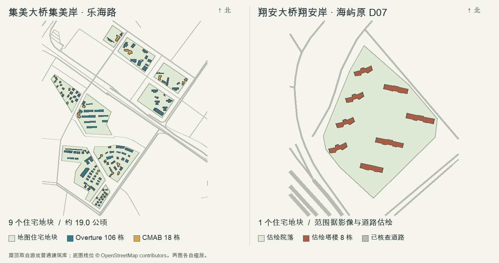

# 普通住宅第二批实拍复核

从[起飞大厅](http://127.0.0.1:5187/)打开航线图，或用下表直达。飞行中按 **M** 切换地点。两个桥头各自计数，首批厦门大桥集美岸另见[首批记录](../README.md)。

| 机位及本次范围 | 普通建筑库变化 | 游戏实拍 |
| --- | --- | --- |
| [绿泉新村南排中段](http://127.0.0.1:5187/?tour=lvquan-row&time=afternoon)，118.10971–118.11013°E，24.47557–24.47575°N | 3 条归并为 1 栋，东侧独立楼保留 | [同机位对比](lvquan-comparison.jpg) · [改前原图](before-lvquan.png) · [改后原图](after-lvquan.png) |
| [集美大桥集美岸乐海路](http://127.0.0.1:5187/?tour=lehai-blocks&time=afternoon)，9 个地块，118.09990–118.10758°E，24.58239–24.59179°N | 0 → 124 栋，均有来源轮廓 | [同机位对比](lehai-comparison.jpg) · [改前原图](before-lehai.png) · [改后原图](after-lehai.png) |
| [翔安大桥翔安岸海屿原 D07](http://127.0.0.1:5187/?tour=xiangan-d07&time=afternoon)，8 栋塔楼占地位于 118.20135–118.20334°E，24.57055–24.57239°N | 0 → 8 栋，位置、平面和高度均属估绘 | [同机位对比](xiangan-comparison.jpg) · [改前原图](before-xiangan.png) · [改后原图](after-xiangan.png) |

## 绿泉新村的屋顶和真通道

固定南侧斜视机位后，能看见原中央住宅被两道缝切开，西段比另外两段矮约 5.6 米。把原轮廓和独立航片转到相同屋檐方向后，中央三段共用连续的长檐。再向东，下一栋有独立端墙及地面通道。只归并这三段，长轴取东偏北约 16°。合并后至东侧原楼的模型净距为 8.64 米，东侧楼仍为原数据的 22.9 米。中央楼高取原三段 18.4、24、24 米的中位数，统一为 **24 米估值**。东端约 2 米的平面折进和屋顶附属物也属近似。本次校核仅覆盖南排中段。[绿泉新村用地](https://www.openstreetmap.org/way/1311230642) · [独立航片局部](https://services.arcgisonline.com/ArcGIS/rest/services/World_Imagery/MapServer/export?bbox=118.10925,24.47536,118.11055,24.47599&bboxSR=4326&imageSR=4326&size=1200,640&format=jpg&f=image)

## 两处桥头的范围和估算



**乐海路。** 样区沿两侧已建住宅地块取界，合计 190,037 平方米。OSM 用地编号为 675481334、675481337、675481339、675481345、675481347、675481353、675481356、1568015907、1568015908。可识别的小区包括国贸商城·集悦和泉舜·泉水湾一期。47 个相近屋面的配对投票用于校准本地 CMAB 数据，在原投影基础上向西修正 12 米、向南 0.5 米。相交时优先保留 Overture 原轮廓，最终采用 Overture 106 个和 CMAB 18 个。每个轮廓须落入一个住宅地块并避开道路、操场、水域、工地等预留。半米量化后，相邻来源轮廓最大的边缘交叠为 0.44 平方米。[国贸商城·集悦](https://www.openstreetmap.org/way/1568015907) · [泉舜·泉水湾一期](https://www.openstreetmap.org/way/1568015908) · [Overture 建筑主题](https://docs.overturemaps.org/guides/buildings/) · [东亚建筑数据](https://doi.org/10.5281/zenodo.8174931) · [CMAB V7](https://doi.org/10.6084/m9.figshare.27992417.v7)

其中 51 栋采用遥感模型估高。另 73 栋按同一地块内面积相近、已有来源高度的至多 7 栋邻楼取中位数，无可用邻楼时按面积及小区类型回退至 9、18 或 48 米。逐栋有实测高度或地图层数的数量为 0。新增屋顶与手工桥梁、接线和匝道中心线的最近距离为 66.8 米，与本次核查的地面机动车道路中心线最近为 10.6 米。

**翔安岸。** 从桥头沿通道核过互通、未建地和建设用地后，本次选择翔安南路与滨海东大道交叉口东侧的海屿原 D07。项目披露列明此处为 2022XP04 号住宅地块，面积 36,093.37 平方米。地面绘制边界以道路和影像近似，面积 36,142 平方米。逐栋对照后，OSM、Overture 与 CMAB 样区内均缺少能代表这八栋现楼的轮廓。航片能辨认出两列塔楼及院落，据此估绘 4 栋蝶形塔楼、4 栋板式塔楼，按各列方向与尺度成组布置。塔楼之间最窄 28.9 米，距手工桥梁或匝道中心线最近 55.4 米，距核查地面机动车道路中心线最近 10.0 米。[项目地块披露，第 129 页](https://static.sse.com.cn/disclosure/bond/announcement/company/c/new/2023-06-16/115548_20230616_STHT.pdf#page=129) · [互通及住宅航片](https://services.arcgisonline.com/ArcGIS/rest/services/World_Imagery/MapServer/export?bbox=118.198,24.568,118.206,24.576&bboxSR=4326&imageSR=4326&size=1200,1200&format=jpg&f=image)

D07 的塔楼基底、翼部尺寸及 **90–99 米楼高均为估算**。两处桥头的绿化、宅间铺装、立面及楼顶附属物均按航拍尺度表达。道路走向取自地图，路宽按等级估算。滨水滩地、相邻工地、公共开敞地和体育场周边留在住宅范围之外。[数据署名](../../../public/geo/credits.json)

## 实机、帧间隔和复建

生产版从起飞大厅打开航线图，分别进入三个子机位，核对对应 HUD；三条直达链接也逐一打开。三处切换期间没有记录到页面异常、控制台错误或失败的 HTTP 资源。另在同版本街区数据的测试副本上逐栋查询障碍高度，绿泉 1/1、乐海路 124/124、D07 8/8 均返回高于当地地面的楼体。三处楼列沿用普通建筑分块加载，纳入已复核建筑的常驻组。

帧耗为同一 Chromium 浏览器的相邻动画帧间隔。用隔离的游戏副本固定工作区内其他内容和采样条件，对照本批改前及改后数据与渲染。固定晴天 15:00、云量 0.12、薄雾 0.045、时间倍率 0。视口 1800 × 974，绘制缓冲 1620 × 876。各机位沿同一段 76 帧轨迹平移并升降、收窄视场，预热一遍，随后三遍各取后 64 帧，共 192 个样本。每组原图取自轨迹起点。以下数值是整帧间隔，包含浏览器调度。

| 机位 | 中位数改前 → 改后 | P95 改前 → 改后 |
| --- | --- | --- |
| 绿泉新村 | 33.3 → 33.4 ms | 42.0 → 41.7 ms |
| 乐海路 | 33.4 → 33.3 ms | 41.8 → 41.7 ms |
| 海屿原 | 33.4 → 33.5 ms | 41.9 → 45.8 ms |

翔安岸最终复拍采用校正过宅地边界的地面。该处 P95 比基线高 3.9 毫秒。这个采样比较反映整段飞行的实测差异，无法拆分建筑、地面和浏览器调度各自的耗时。[改前统计](before-frames.json) · [改后统计](after-frames.json)

固定相机采用游戏世界坐标，单位米。依次为相机 XYZ、目标 XZ、目标世界高度、垂直视场角。

| 机位 | 相机 | 目标 | 目标高度 | 视场角 |
| --- | --- | --- | --- | --- |
| 绿泉新村 | −1524, 94, 553 | −1524, 480 | 24 | 48° |
| 乐海路 | −1670, 289, −11490 | −2115, −11840 | 18 | 54° |
| 海屿原 | 7440, 215, −10015 | 7790, −10220 | 49 | 47° |

全库从 31,091 条变为 31,221 条。与上一批二进制逐条比较，有 31,088 条记录的每个字节均一致，移除 3 段原楼形，写入 133 条本批记录。数据复建有两种入口。按[项目 README](../../../README.md)生成基础 city-layout 后运行下方脚本，或用 `--bridge-districts-only --input 原首批.bin --manifest 原首批.json` 从已完成四片区的 31,091 条快照增量生成。普通建筑和两个桥头的地面图集均在同次处理产出。建筑二进制的完整重建与增量结果一致，SHA-256 为 `3224a2cfab998ad1ac009b51422d43f219887b07947ab4896aaf690c5771d60f`。[生成脚本](../../../tools/prepare-district-buildings.py) · [数据清单](../../../public/geo/city-layout.json)

```sh
uv run tools/prepare-district-buildings.py
npm run build
```

生产构建通过。Vite 仍提示部分 JavaScript 分块超过 500 kB。上述游戏链接使用本机端口 5187，服务关闭后可双击项目内的「开始飞行.command」重新启动。
