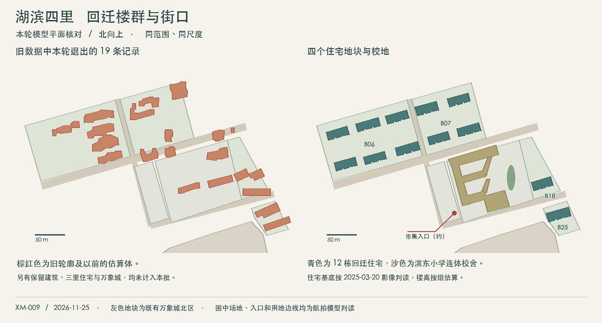

# XM-009 湖滨四里回迁街区

基准日为 2026 年 11 月 25 日。生产入口已接入航线图「厦门站」下的两个机位。两处直达入口均使用午后光照。XM-011 负责游戏截图、实飞、实际遮挡和帧耗验收。

| 游戏入口 | 从空中复核的特征 |
| --- | --- |
| [回迁社区总览](http://127.0.0.1:5187/?tour=hubin-sili&time=afternoon) | 从东南看向湖光路。近侧校地留出运动场，远侧两块住宅分别为两排各三栋、两排各两栋。另两栋沿东侧分列于校地旁、学校南侧街口。 |
| [院落街口](http://127.0.0.1:5187/?tour=sili-court&time=afternoon) | 从万象城北区上方看向学校与住宅之间的路口，可拉近校侧的下行台阶和「四里菜市场」门头，再沿街看 B07 两排之间的院落。 |

## 交付范围

整个一至四里工程东至湖滨东路、西至湖滨中路、南至湖滨南路、北至湖光路，共 45 栋住宅。三、四里共有 25 栋，住宅用地涉及 B06、B07、B15、B18、B22、B25。本次取可按施工、交付资料与影像互证的四里九龙标段，覆盖 B06、B07、B16、B17、B18、B25。B15、B22 归相邻三里批次。本次六块模型占地合计约 4.83 公顷，采用可辨街沿和保留楼边界裁切；行政社区与法定宗地界址另计。[实施方案](https://www.governbond.org.cn/uploadFiles/3502/attachFiles/202307/01e644ef-f37a-4717-9cfb-d2d857aa9d46.pdf) · [全区竣工与交房](https://news.xmnn.cn/xmxw/202501/t20250104_291536.html) · [住宅用地清单](https://www.fjdaily.com/app/content/2025-01/03/content_3023447.html) · [三四里 25 栋回迁楼的现场记录](https://dzb.sunnews.cn/page/2026-02/10/A03/hxcb20260210A03.pdf) · [九龙标段 12 栋与地块清单](https://news.xmnn.cn/xmxw/202312/t20231202_115856.html)

| 用地 | 实际制作 | 估算边界 |
| --- | --- | --- |
| B06 | 6 栋，两排各 3 栋与中间院落 | 影像提供落位、间距、朝向及面宽。报道确认 4 号楼为 26 层、80.60 米，楼号尚未逐一配准。模型南排取 81–85 米，北排取 94–96 米。 |
| B07 | 4 栋，两排各 2 栋，东侧保留原有街角建筑 | 采用与 B06 相同的住宅类型，模型楼高 90–98 米。深度、阳台凹入、屋顶机房和绿化为成组估算。 |
| B18、B25 | 东侧各 1 栋，校地旁和街口各保留一块空地 | 模型分别取 87、91 米。南侧万象城北区和原有加油站另有边界。 |
| B16、B17 及沿街 | 滨东小学连体教学楼、内院、运动场、蓝色屋顶、相邻可见低层体量、街口与半地下市集门面 | 小学地址、六层和启用事件有报道。屋顶运动场细线、配套楼层高及市集门面尺寸、朝向和门址为近似。市集制作范围止于可见入口。 |
| 街巷与既有数据 | 两组住宅间和学校周边按影像接通四段道路，清退地块内 15 条及道路上 4 条旧记录 | 街道端点按影像接线，路幅、灯窗、绿化和院内铺装不具备测绘精度。 |

[已核实的 B06 高度与层数](https://siming.xmnn.cn/tzsm/202308/t20230823_151899.htm) · [新校园的地址与连体形态](https://xm.fjsen.com/wap/2025-08/29/content_32027553.htm) · [市集与学校、万象城二期的邻接关系及现场照片](https://xm.fjsen.com/2026-08/24/content_32240095.htm)

## 采用的时相

| 原始观测或事件日 | 对应范围及用途 |
| --- | --- |
| 2024 年 12 月、2025-01-03 | 全区住宅通过竣工验收，1 月 3 日举行返迁交房仪式。分户入住时间按实际办理进度。[交房报道](https://www.fjdaily.com/app/content/2025-01/03/content_3023447.html) |
| 2025-03-20 | Vantor LG04 高分辨率图像，与楼列、错位、学校运动场、校舍及邻地施工界面逐片对位。识别服务在样区内返回 0.34 米分辨率与 8.47 米标称精度。楼顶有侧视位移，底脚作了小幅统一校正。南侧当时可见的施工状态未写入回迁住宅。[原始元数据回执](world-imagery-identify.json) · [可查询的 Esri 影像服务](https://services.arcgisonline.com/ArcGIS/rest/services/World_Imagery/MapServer/identify?geometry=118.10386%2C24.47937&geometryType=esriGeometryPoint&sr=4326&mapExtent=118.100%2C24.476%2C118.108%2C24.483&imageDisplay=1780%2C1680%2C96&tolerance=1&returnGeometry=false&f=pjson) |
| 2025-08-28 | 滨东小学四里校区启用，湖滨四里 80 号，地上六层。新校落在湖光路南，旧地图的湖光路北点位属于过渡校址。[启用仪式](https://xm.fjsen.com/wap/2025-08/29/content_32027553.htm) |
| 2026-08、2026-09-12 | 学校与万象城二期旁的原址市集在 9 月 12 日重开。按现场图文制作半地下入口、台阶、白底红砖山墙及旧名招牌。8 月 24 日为报道日，配图具体拍摄日未披露。[入口照片及邻街关系](https://xm.fjsen.com/2026-08/24/content_32240095.htm) · [重开日期](https://news.xmnn.cn/xmxw/202609/t20260914_450764.html) · [半地下形态现场记录](https://news.xmnn.cn/xmxw/202609/t20260913_450651.html) |
| 2026-10-20 | 省政府转载的走访记录了当日下午四里社区党群活动中心的居民活动。资料能确认回迁后的使用状态，无法逐栋定位其入口。模型仅给有位置依据的设施挂名。[回迁后的四里社区](https://fj.gov.cn/xwdt/mszx/202610/t20261027_7240737.htm) |
| 2026-11-10 10:51 北京时间 | Sentinel-2A 的 10 米真彩色切片覆盖本批及南侧邻区，用于复核大体量、开敞场地与城市更新后的整体格局。11 月 13 日和 23 日的同区观测受云遮挡。单栋外墙、门址和高度仍以上述更高分辨率影像和现场报道为限。[原始影像产品与采集时间](https://earth-search.aws.element84.com/v1/collections/sentinel-2-l2a/items/S2A_50RPN_20261110_0_L2A) · [本次裁切，含修改的 Copernicus Sentinel 数据 2026](sentinel-20261110.png) |

## 构建与复核

- 本轮生产构建通过，Vite 转换 150 个模块。构建记录中的入口为 `index-C8NpPUQM.js`，游戏包为 `game-BE2Vx0A-.js`，有超过 500 kB 的分包提示。两个正式入口均返回 HTTP 200，服务返回的入口脚本与本机生产文件逐字节一致。
- 住宅沿用普通建筑的分块加载、碰撞和远景渲染。离线实际运行了建筑及校地网格生成，12 栋均写入障碍索引。住宅共 1,776 个三角形，学校、街巷和公共空间共 4,529 个，顶点均为有限值。6 块边界无相互占地，和万象城手工占地相交面积为零。湖光路北的南湖公园及其地标保持独立。
- 按 16:9 透视、现有地形、附近普通楼与万象城网格做几何视线检查。总览 12 个抽样屋顶都在镜内且视线畅通。街口机位可见 10 个抽样屋顶；B07 院心、学校运动场、市集入口三处均在两机位视锥内，检测射线畅通。B06 的院心在两处视角均被自家楼排遮住，可绕至上方复核。[离线几何检查结果及清退记录](geometry-audit.json)
- 按总调度串行安排，XM-009 本轮仅完成数据、离线几何、构建与入口检查。开发阶段未启动游戏浏览器，未创建验证 Space。两张正式游戏画面、动态遮挡、帧耗与实飞结果由 XM-011 在共享入口统一验收。
