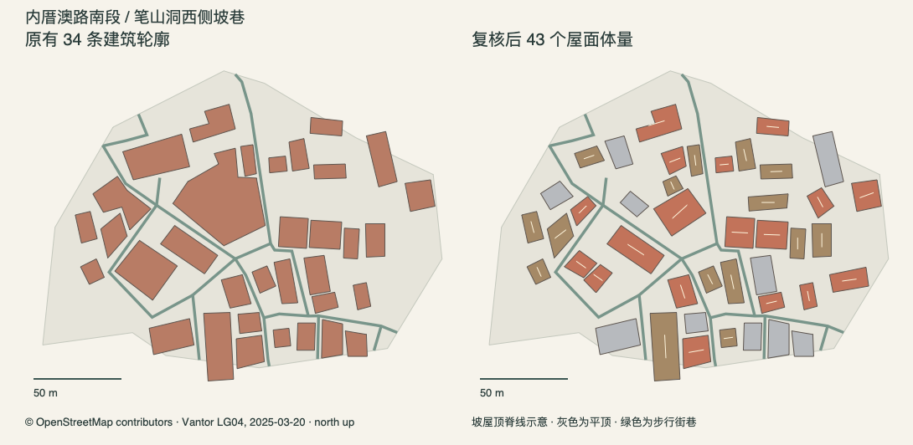

# XM-008 鼓浪屿普通住宅 · 内厝澳至笔山路

基准日为 2026 年 11 月 25 日。这个首次精修范围沿内厝澳路南段，从康泰路转入居民街巷的西北街口，经内厝澳路折角和支巷交会，到笔山洞西口前的坡巷折点。主线长约 215 米，连同两侧连续街坊约 2.79 公顷。起点为 118.05875°E、24.44889°N，终点为 118.06041°E、24.44794°N。[康泰路接点](https://www.openstreetmap.org/way/198040136) · [内厝澳路折角](https://www.openstreetmap.org/way/905736887) · [笔山洞西侧坡巷](https://www.openstreetmap.org/way/552998335) · [隧道地图线](https://www.openstreetmap.org/way/552998336)

| 游戏入口 | 最短复验 |
| --- | --- |
| [内厝澳 · 屋顶低空](http://127.0.0.1:5187/?tour=neicuoao-roofs&time=afternoon) | 从西南往街坊看，检查红瓦双坡、四坡和灰平顶是否成组错开。沿下方折角看内侧院落，旧版连成整屋面的四块仍可按图定位。 |
| [笔山路 · 坡巷街口](http://127.0.0.1:5187/?tour=bishan-lane&time=afternoon) | 朝笔山洞方向看近墙、路面和屋基，向前缓移十几米并转看左右支巷，检查是否有楼体压路、墙脚悬空或镜头跳升。 |

可从「航线图 → 鼓浪屿」进入两处，也可直接打开上表链接。按 **F** 回到飞行。独立实机同时复开 [全岛鸟瞰](http://127.0.0.1:5187/?tour=gulangyu) 和 [黄荣远堂](http://127.0.0.1:5187/?tour=huangrongyuan)，核对近景机位与整岛入口。

## 建筑记录与边界

当前共享 XMC1 二进制按游戏的轮廓平均点与岛岸线复算，鼓浪屿有 **1,150 条岸内建筑记录**，其中 **24 条**落在现版手工地标预留内。这是在当前源码、含黄荣远堂预留所测的值。此前的 1,135 处采用了另一版或统计口径，现有材料无法还原差额的逐条来源。岛内记录中只有 2 个内环，11 条带已知高度标志。样区 34 条旧记录均缺已知高度，旧普通楼外形以最宽墙边决定屋脊方向，坡顶、色调和附加构件有通用估算。

样区 34 条当前 OSM 唯一匹配的旧记录中，**30 条保留现有建筑外环**，4 条院落或连片外壳改为 10 个可辨屋面，另有 3 个影像清楚且与旧轮廓无占地交叠的体量补入。完成 **43 个屋面体量**，其中 15 个双坡、18 个四坡、10 个平顶。影像可辨长轴及方向用于屋脊，楼高和檐口仍逐栋估算，主体基准高度约 3.3–11.1 米。分栋是对地上屋面和可见院落的判读，门号、地籍、相邻低层连通处和楼层数未作实地认定。[样区数据和 OSM ID](../../../src/gulangyu-neicuoao.json) · [院落实例 OSM 1244520299](https://www.openstreetmap.org/way/1244520299)

保留 13 条公开地图街巷的中心线及原有游戏步行道路接法。笔山洞按地下隧道处理，样区走到西侧坡巷折点。住宅屋基以游戏现有 10 米地形为准，沿墙采样压住坡脚，上部墙线与屋脊随栋错台。光学影像中树冠遮住的小附房、围墙细线、露台材质、屋基实际标高和 2025 年道路提升工程的铺装完成状态，仍待能定位的地面资料。[国家文物局 2025-03-24 批复全文转载](https://www.055110.com/law/1/58179.html)



## 原始来源和日期

| 日期 | 覆盖与用途 |
| --- | --- |
| 2018-11-13 至 2024-01-30 单栋编辑，2026-11-25 下载 | 以 OSM API 原始 way 的 ID 和坐标查逐栋轮廓，检查院落及 13 条街巷。建筑外环与游戏旧轮廓的交并比为 0.91–0.99。编辑日期代表制图提交日期。[OpenStreetMap 样区](https://www.openstreetmap.org/#map=18/24.44842/118.05970) · [OSM 权属与 ODbL](https://www.openstreetmap.org/copyright) |
| 2025-03-20 原始拍摄 | Vantor LG04 0.34 米光学影像覆盖整个样区，四个抽查点返回同一景。用于区分屋面、空院、台阶附近道路和植被。服务标注的定位精度为 8.47 米，局部轮廓受遮挡与屋顶视差影响。[Esri 影像识别服务](https://services.arcgisonline.com/ArcGIS/rest/services/World_Imagery/MapServer/identify?geometry=118.059697%2C24.448425&geometryType=esriGeometryPoint&sr=4326&mapExtent=118.0574%2C24.4472%2C118.0615%2C24.4511&imageDisplay=1200%2C1260%2C96&tolerance=1&returnGeometry=false&f=pjson) · [四点元数据](imagery-metadata.json) |
| 2026-11-10 10:51 北京时间原始采集 | Sentinel-2A 50RNN 的 10 米真彩色切片复核了街坊体量与两侧树带。11 月 13 日及 23 日更晚观测在样区有云。2026 年影像不能判读单栋屋脊和增改建，2025-03-20 仍是本次逐屋细节最后可定年的影像。[原始产品与采集时间](https://earth-search.aws.element84.com/v1/collections/sentinel-2-l2a/items/S2A_50RNN_20261110_0_L2A) · [本次裁切，含修改的 Copernicus Sentinel 数据 2026](sentinel-20261110.png) |
| 2021 年省政府保护规划批复、2023 年居民建筑调查发表 | 保护规划用于确认传统步行尺度和建筑格局应保留。建筑调查有内厝澳沿等高线分布、一二层居多的记录，用作楼型估算依据。调查配图的逐屋拍摄日期未披露。[省政府批复](https://zfgb.fujian.gov.cn/9237) · [研究作者发布的调查](https://www.sohu.com/a/714085636_121123902) |

## 接入、构建与离线检查

岛内专用 [街坊数据](../../../src/gulangyu-neicuoao.json) 由 [接入模块](../../../src/gulangyu-neicuoao.js) 提供 34 个轮廓匹配键、对应 OSM ID 和 3 个仅来自影像的体量。普通城市加载按命中的旧轮廓在同一分块中替换，沿用原有地标占地过滤。屋顶与贴坡墙体由既有岛上住宅模块绘制。两个机位导出为 `neicuoaoViews`，已注册到现有 `islandViews`。XM-008 合并当前共享源码后可直接构建，无需另挂运行资源或再注册导航。

本地生产构建通过，入口脚本 `index-BvhxVI3L.js` 与游戏包 `game-CJCCvZNu.js`。复核时 5187 正提供同一入口脚本，游戏包含新住宅分支，两处新机位和整岛、黄荣远堂、内厝澳码头直达均返回 HTTP 200。离线组合初始化岛上手工地标与普通建筑，43 个屋面都写入碰撞索引，检查了住宅墙边与地标占地，13 条街巷共 1,403 个中心点没有碰撞。屋顶机位在 16:9 下 43 个屋面抽样点可见，手机竖屏下 42 个可见。巷口机位高于地面 3.84 米，近墙自然遮住部分屋顶。浏览器画面、实际沿巷移动、树冠遮挡与帧耗留给独立实机检查。本轮没有生成验证 Space。[可复算几何结果](geometry.json)

在仓库根目录运行以下命令可重做平面对照及几何检查。

```sh
node tools/check-gulangyu-neicuoao.mjs /tmp/neicuoao-footprints.svg
sips -s format png /tmp/neicuoao-footprints.svg --out /tmp/neicuoao-footprints.png
```
